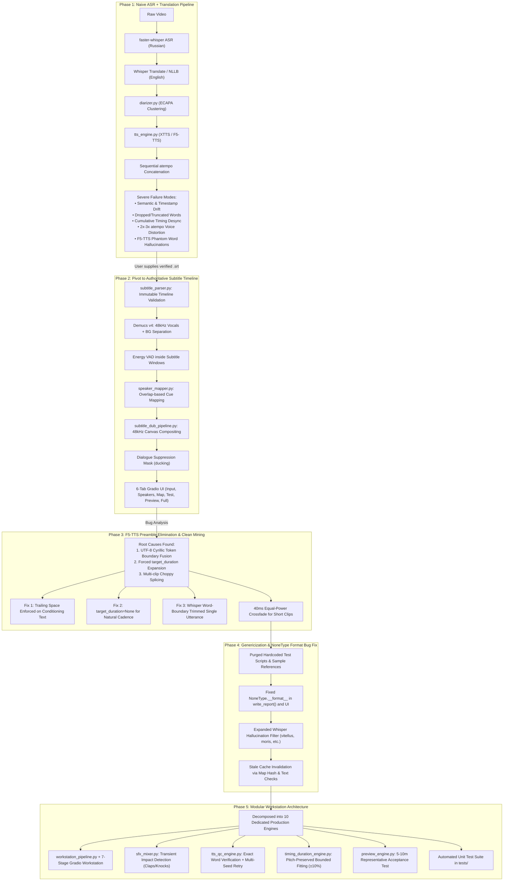
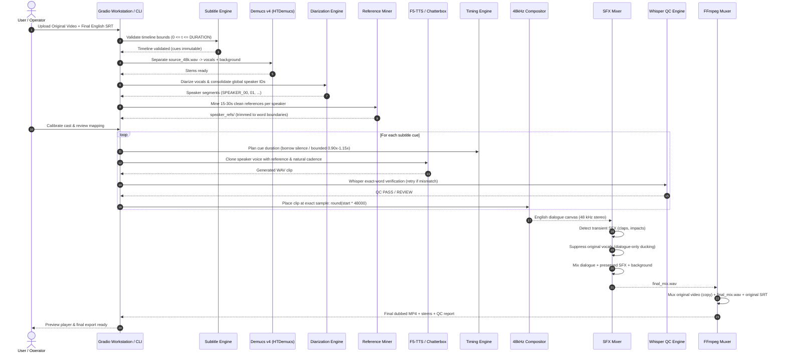

# LocalDub Workstation: Comprehensive Agent Handoff & Architecture Blueprint

> **Notice for Incoming Agents & Engineers:**
> This document is the single source of truth for the **LocalDub** project. It chronicles the full historical evolution of the system, details every component and subsystem, explains the core mathematical and acoustic contracts, and provides a guide for immediate development, testing, and debugging.

---

## 1. Executive Summary & Mission

**LocalDub** is a 100% offline, local AI video dubbing workstation designed to take **ANY original video** and **ANY verified target-language subtitle file (`.srt` / `.vtt`)**, producing a professional, broadcast-quality dubbed film where:
1. Every actor speaks in their **actual cloned voice** (cross-lingual zero-shot voice cloning).
2. The original soundtrack, background music, room tone, and sound effects (claps, footsteps, table knocks, impacts) are **100% preserved**.
3. Timing is **sample-accurate at 48,000 Hz**, eliminating cumulative drift.
4. Voice timing is adjusted naturally without extreme `atempo` chipmunk or demonic distortion.
5. All operations run strictly locally on consumer GPU hardware (NVIDIA RTX 4050 6GB VRAM, CUDA 12.4) with zero external API calls and zero cloud censorship.

### The Cardinal Rule (The Inviolable Contract)
```
THE SUBTITLE FILE IS 100% AUTHORITATIVE.
```
- **DO NOT** perform automatic speech transcription (ASR) to generate English dialogue.
- **DO NOT** run Whisper `task="translate"` or NLLB machine translation.
- **DO NOT** summarize, rewrite, or alter subtitle text or timestamps.
- The supplied subtitle file dictates **WHAT** is spoken and **WHEN** it is spoken.
- The source video audio dictates **WHO** speaks it (diarization) and **HOW** they sound (voice cloning).

---

## 2. Chronological Evolution & History Events Chart

The table and flowchart below trace the architectural decisions, failure modes encountered, root causes identified, and solutions engineered throughout the project's development.



### Detailed Event Log & Rationale

| Phase | What Was Implemented | Why It Failed / Shortcoming | Resolution / What Was Implemented Next |
| :--- | :--- | :--- | :--- |
| **Phase 1: Legacy ASR Pipeline** | `dubbing_pipeline.py`, `transcriber.py`, `translator.py`, sequential segment concatenation via FFmpeg `atempo`. | • Whisper hallucinated phantom lines on silence/music.<br/>• Machine translation altered sentence lengths, causing massive timing drift.<br/>• Sequential concatenation (`current_time += dur`) accumulated drift over minutes.<br/>• High `atempo` speeds (1.8x–3.0x) rendered speech completely unnatural. | **Complete Paradigm Shift**: Abandoned automatic translation and transcription. Switched to user-provided, verified English subtitle files as the immutable, authoritative master timeline. |
| **Phase 2: Authoritative Subtitles** | `subtitle_parser.py`, `speaker_mapper.py`, `cache_manager.py`, `subtitle_dub_pipeline.py`, 6-tab Gradio UI. | • Diarization on raw audio leaked background music into speaker embeddings.<br/>• Basic TTS reference generation spliced multiple random cuts, causing F5-TTS to hallucinate preamble syllables (*"Wait, wait,"*, *"What can you do?"*).<br/>• PyAV API mismatch crashed Whisper on raw audio paths. | • Added Demucs v4 vocal/background separation.<br/>• Fed isolated vocals through energy VAD inside subtitle windows to SpeechBrain ECAPA.<br/>• Decoded audio via FFmpeg to 16 kHz float32 arrays before passing to Whisper. |
| **Phase 3: F5-TTS Precision Engineering** | Investigated root causes of TTS preambles and hallucinated starter words. | Root Cause 1: In `f5_tts/infer/utils_infer.py`, Cyrillic characters (2 bytes) failed the single-byte check, fusing the reference prompt with the generation prompt without a space.<br/>Root Cause 2: Forcing `target_duration` to fill the window caused F5-TTS to insert filler syllables.<br/>Root Cause 3: Splicing 4–5 choppy audio segments created unnatural phonetic cuts. | • Enforced trailing space on `clean_ref_text`.<br/>• Set `target_duration = None` for natural cadence whenever `natural <= max_window`.<br/>• Built clean single-utterance reference selection (3.0s–8.0s) trimmed to exact word boundaries (+/- 40ms) using Whisper word timestamps.<br/>• Added 40ms equal-power linear crossfade (`_crossfade_join`) for joining short clips. |
| **Phase 4: Genericization & Bug Squashing** | Removed all hardcoded test video filenames, sample quotes, and pilot test scripts. Cleaned `temp/` and `outputs/`. | During 60s preview render, synthesis hit 93% and crashed with: `TypeError: unsupported format string passed to NoneType.__format__` when writing `dub_report.csv` because `p["target"]` was `None` for natural speech. | • Guarded all report formatting with `planned_str = f"{p['target']:.3f}" if p.get("target") is not None else "natural"`.<br/>• Expanded `_HALLUCINATIONS` to block Whisper Latin/Welsh tokens (`vitellus`, `moris`, `orbitus`).<br/>• Added cache validation to reject cached profiles containing hallucinated text. |
| **Phase 5: Modular Workstation Architecture** | Decomposed the monolithic pipeline into 10 decoupled production engines (`workstation_pipeline.py`, `subtitle_engine.py`, `diarization_engine.py`, etc.). | The application needed enterprise reliability: transient SFX (claps, footsteps, table knocks) were getting lost inside dialogue ducking windows; word completeness wasn't formally scored; long preview evaluation was missing. | • Built `sfx_mixer.py` with spectral flux transient detection to re-inject non-dialogue impacts into speech windows.<br/>• Built `tts_qc_engine.py` for exact word Whisper verification with multi-seed regeneration.<br/>• Built `preview_engine.py` with 5–10 min representative window selection and automated acceptance testing.<br/>• Built full unit test suite in `tests/`. |

---

## 3. Repository Directory & File-by-File Technical Guide

```
Russian to English dubb/
├── app.py                      # 7-Stage Gradio Workstation Web Interface
├── cli.py                      # Command-Line Interface (--preview, --full)
├── config.py                   # Global constants, paths, sample rates, thresholds
├── run.bat                     # Windows launch script (activates venv, starts app.py)
├── requirements.txt            # Python dependencies (pinned versions)
├── README.md                   # User-facing workstation documentation
├── AGENT_HANDOFF_GUIDE.md      # This comprehensive engineering blueprint
│
├── [Core Production Engines - Workstation V2]
├── workstation_pipeline.py     # Master orchestrator for the 7-stage workstation
├── subtitle_engine.py          # Deterministic SRT/VTT parsing & immutable validation
├── diarization_engine.py       # Full-video diarization & global speaker consolidation
├── cue_mapper.py               # Cue-to-speaker temporal overlap & confidence scoring
├── reference_miner.py          # Full-video 15-30s clean reference audio mining
├── timing_duration_engine.py   # Bounded time-scale modification & silence borrowing
├── timeline_compositor.py      # Sample-accurate 48 kHz dialogue canvas compositing
├── sfx_mixer.py                # Demucs vocal separation, transient preservation & mixing
├── tts_engine.py               # F5-TTS / Chatterbox TTS & Seed-VC timbre transfer
├── tts_qc_engine.py            # Local Whisper exact-word QC & multi-seed retry
├── preview_engine.py           # 5-10m representative preview selection & acceptance test
├── performance_analyzer.py     # Acoustic prosody analysis (energy, pitch movement)
│
├── [Pipeline V1 Implementations - Fully Functional Predecessors]
├── subtitle_dub_pipeline.py    # Self-contained subtitle dubbing pipeline
├── subtitle_parser.py          # SubtitleCue dataclass & parsing utilities
├── speaker_mapper.py           # Overlap mapping & speaker merge utilities
├── cache_manager.py            # Stage-based SHA256 caching & invalidation
├── diarizer.py                 # SpeechBrain ECAPA-TDNN diarizer & VAD
├── audio_extractor.py          # FFmpeg audio probe and 48 kHz extraction
├── audio_mixer.py              # Stereo canvas mixing and sidechain ducking
├── timeline_validator.py       # Timeline boundary and drift sanity checker
├── test_timeline_validator.py  # Unit tests for timeline invariants
│
├── tests/                      # Automated Workstation Test Suite
│   ├── test_srt_engine.py              # Subtitle parsing & immutability tests
│   ├── test_timing_and_compositor.py   # Canvas placement & sample accuracy tests
│   ├── test_word_qc.py                 # Exact-word Whisper QC tests
│   └── test_mixer_and_transients.py    # SFX preservation & crossfade tests
│
├── models/                     # Local model weights & checkpoints
│   ├── ecapa/                  # SpeechBrain ECAPA-TDNN embedding extractor
│   ├── f5-tts/                 # F5-TTS zero-shot voice cloner weights
│   └── vocos/                  # Vocos 24 kHz neural vocoder
│
├── outputs/                    # Output directory for renders, stems, and reports
├── temp/                       # Temporary workspace (uploads, demucs stems, gradio cache)
└── venv/                       # Complete Python 3.12 virtual environment (CUDA 12.4)
```

### Detailed Component Roles

#### 1. `app.py` (Workstation UI)
- Implements a modern Gradio interface structured into 7 logical tabs:
  1. **Input & Validation**: Video & SRT upload, ffprobe duration verification, subtitle bounds checks.
  2. **Full Analysis**: Diarization across entire video, speaker clustering, reference extraction.
  3. **Cast Calibration**: Audition original references vs English clones, choose per-speaker pipeline.
  4. **Subtitle / Speaker Map**: Interactive cue table, manual speaker reassignment, play cue audio.
  5. **5–10m Master Preview**: Generates representative multi-speaker preview with video player.
  6. **QC Dashboard**: Word completeness reports, timing charts, HTML acceptance report.
  7. **Full Render**: Muxes the full film with dubbed audio, stems, and immutable SRT.

#### 2. `subtitle_engine.py`
- Parses SRT and WebVTT into `ImmutableCue` dataclasses (`start_ms`, `end_ms`, `text`, `index`).
- Enforces the timeline invariant: `0 <= start_ms < end_ms <= SOURCE_DURATION_MS + 200ms`.
- Detects overlapping cues, invalid timestamps, or corruption, raising `SRTIntegrityError` immediately.
- Formats cues back to standard SRT without modifying milliseconds.

#### 3. `diarization_engine.py`
- Runs `pyannote/speaker-diarization-community-1` (or SpeechBrain ECAPA-TDNN) across the entire video.
- Assigns persistent IDs (`SPEAKER_00`, `SPEAKER_01`, ...).
- Implements a global speaker consolidation pass: extracts 192-dim speaker embeddings and merges split identities that share high acoustic similarity and zero temporal overlap.

#### 4. `cue_mapper.py`
- Computes temporal intersection duration between each subtitle cue window and diarization segments.
- Calculates overlap ratio: `intersection_duration / cue_duration`.
- Assigns the dominant speaker to each cue with confidence score.
- Flags cues where overlap ratio is low (<30%) or multiple speakers collide (`ambiguous_speaker`).

#### 5. `reference_miner.py`
- Mines 15–30 seconds of high-quality speech per speaker across the full movie.
- Filters candidate segments: checks SNR, speech confidence, and excludes overlapping speech.
- Uses Whisper word timestamps to trim exact word boundaries (+/- 40ms safety margin), eliminating leading/trailing room noise.
- Normalizes audio peak to -1.4 dBFS (0.85) and guarantees a trailing space on reference text.

#### 6. `timing_duration_engine.py`
- Calculates `natural_duration()` of English subtitle text based on character count, word count, and punctuation pauses.
- If `natural <= window`: sets `target_duration = None` (natural speaking cadence).
- If `natural > window`: borrows non-colliding silence up to 250ms from adjacent gaps.
- If still constrained: applies pitch-preserving time-scale modification strictly bounded within ±10–15% (`0.90x – 1.15x`). Flags `TIMING_REVIEW` if excessive speedup is required.

#### 7. `timeline_compositor.py`
- Allocates an absolute NumPy stereo float32 canvas: `np.zeros((round(SOURCE_DURATION * 48000), 2))`.
- For each generated clip, places audio at exact sample: `start_sample = round(start_sec * 48000)`.
- Applies 8ms linear edge fades to prevent boundary clicks.
- **NEVER** uses cumulative position offsets (`pos += len(clip)`).

#### 8. `sfx_mixer.py`
- Separates original audio into vocals and background stems using Demucs v4 (HTDemucs).
- Computes a dialogue suppression mask exclusively over active subtitle dialogue intervals (+ 80ms ramp).
- Outside dialogue windows, original audio is 100% untouched.
- Detects transient impacts (claps, footsteps, table knocks) via spectral flux in original audio and mixes them back into dialogue windows so physical actions are never muted.

#### 9. `tts_engine.py`
- Encapsulates local zero-shot TTS backends:
  - **F5-TTS**: Fast, high-fidelity diffusion transformer with ConvNeXt V2 and Vocos.
  - **Chatterbox Multilingual V3 / XTTS-v2**: Multilingual voice cloning.
  - **Timbre Refinement**: Optional Seed-VC timbre transfer pass.
- Enforces GPU memory cleanup (`unload_model()`, `torch.cuda.empty_cache()`, `gc.collect()`).

#### 10. `tts_qc_engine.py`
- Runs local Whisper ASR on every synthesized dialogue clip.
- Normalizes recognized text and compares word-by-word against the authoritative subtitle text.
- If words are truncated or substituted, automatically triggers multi-seed regeneration (up to 3 retries with random seeds).
- Outputs a pass/review status for every single subtitle line.

#### 11. `preview_engine.py`
- Scans the subtitle timeline to identify a representative 5–10 minute window containing:
  - Dialogue from all major detected speakers.
  - Diverse speaking rates (fast dialogue and slow pauses).
  - High soundtrack energy (music / SFX present).
- Renders the complete preview and evaluates the **Preview Acceptance Test** (100% word completeness, timing accuracy, soundtrack preservation).

---

## 4. End-to-End Processing Architecture



---

## 5. Critical Invariants & Rules (Must Never Be Broken)

When writing or modifying code in this repository, you **MUST** adhere to the following rules:

### Invariant 1: Subtitle Immutability
```python
# CORRECT:
text = cue.text.strip()  # Text is taken directly from the subtitle file

# FORBIDDEN:
# text = retranscribe_with_whisper(audio)
# text = translate_with_llm(russian_text)
# text = summarize_or_shorten(cue.text)
```
The user's English subtitle file is final and legally/creatively binding. Never generate or rewrite dialogue.

### Invariant 2: Timeline Integrity & Bounds Check
```python
assert 0.0 <= cue.start < cue.end <= SOURCE_DURATION + 0.20
```
Every cue start and end must fall strictly within the video duration determined by `ffprobe`. Container timestamp overflow is clamped to `SOURCE_DURATION`.

### Invariant 3: Absolute Sample-Accurate Canvas Positioning
```python
# CORRECT:
canvas_idx = int(round(cue.start_seconds * 48000))
canvas[canvas_idx : canvas_idx + len(clip)] += clip

# FORBIDDEN:
# current_time += len(clip) / sr
# concatenated_audio.extend(clip)
```
Never concatenate audio sequentially. Cumulative positioning guarantees timing drift over a multi-minute video. Every line is an independent anchor on the global timeline.

### Invariant 4: Natural Duration Before Time-Stretching
```python
# CORRECT:
if natural_duration <= max_available_window:
    target_duration = None  # Generate at natural cadence!
else:
    target_duration = max(max_available_window, natural_duration / 1.15)
```
Forcing F5-TTS to stretch a short sentence across a long subtitle window forces the model to invent preamble words (*"Wait, wait,"*, *"What can you do?"*). Let speech run at its natural duration and rest naturally on the canvas.

### Invariant 5: Reference Text UTF-8 Trailing Space
```python
# CORRECT:
clean_ref_text = text.strip() + " "
```
In F5-TTS, non-ASCII (e.g. Cyrillic) conditioning text without a trailing space fuses with the first token of the target English text, corrupting the first word of every generated sentence.

### Invariant 6: Soundtrack Preservation
```python
# Outside active dialogue windows:
final_audio = original_audio  # 100% untouched bit-perfect original audio

# Inside active dialogue windows:
final_audio = demucs_background + transient_sfx + dubbed_english_dialogue
```
Never replace the entire movie soundtrack with Demucs background. Demucs introduces minor phase distortion and low-frequency artifacts. Only duck the original audio during the exact windows where someone speaks.

---

## 6. Hardware Specifications & VRAM Management

### Target Environment
- **Operating System:** Windows 11
- **Python Version:** 3.12 (via `venv\Scripts\python.exe`)
- **GPU:** NVIDIA GeForce RTX 4050 Laptop GPU (6.0 GB VRAM)
- **CUDA Version:** 12.4
- **PyTorch:** `2.6.0+cu124`

### Strict VRAM Management Protocol
Because consumer laptop GPUs have limited VRAM (6 GB), multiple heavy models (Demucs, SpeechBrain ECAPA, Whisper Large-v3, F5-TTS) **CANNOT** reside in VRAM simultaneously.

The pipeline uses strict sequential lifecycle management:
```python
def _free_gpu():
    import gc
    import torch
    gc.collect()
    if torch.cuda.is_available():
        torch.cuda.empty_cache()
        torch.cuda.ipc_collect()
```
- **Demucs** runs during audio preparation -> unloaded.
- **SpeechBrain / pyannote** runs during diarization -> unloaded.
- **Whisper** runs during reference mining & QC -> context-managed via `_Whisper()` with `__exit__` unloading.
- **F5-TTS** runs during voice synthesis -> unloaded via `cloner.unload_model()`.

---

## 7. How to Run, Test, and Verify

### 1. Launching the Web Interface
Run the batch script:
```powershell
.\run.bat
```
Or directly from PowerShell:
```powershell
.\venv\Scripts\python.exe app.py
```
Open **[http://127.0.0.1:7860](http://127.0.0.1:7860)** in your browser.

### 2. Running via Command-Line Interface (CLI)
```powershell
# Render a fast 60-second preview:
.\venv\Scripts\python.exe cli.py "C:\path\to\video.mp4" "C:\path\to\subs.srt" --preview-seconds 60

# Render the complete movie:
.\venv\Scripts\python.exe cli.py "C:\path\to\video.mp4" "C:\path\to\subs.srt"
```

### 3. Running the Automated Test Suite
```powershell
# Run all workstation unit tests:
.\venv\Scripts\python.exe -m unittest discover -s tests -p "test_*.py"

# Run timeline validator sanity audit:
.\venv\Scripts\python.exe test_timeline_validator.py
```

### 4. Inspecting Outputs
Outputs are organized neatly in `outputs/<video_stem>/`:
- `preview_0-60s/` or `full/`:
  - `english_dubbed_final.mp4` / `preview_dubbed.mp4`: Complete remuxed video.
  - `final_mix.wav`: Broadcast 48 kHz 24-bit PCM master mix.
  - `dub_voice_only.wav`: Isolated English dialogue track.
  - `background_only.wav`: Isolated preserved soundtrack with dialogue ducked.
  - `dub_report.csv`: Complete line-by-line QC, timing, and ASR audit.
  - `speaker_map.json`: Mapped subtitle cues with speaker IDs and confidence scores.

---

## 8. Summary for the Next Agent

If you are asked to make changes, add features, or troubleshoot:
1. **Never break the subtitle contract:** The `.srt` / `.vtt` file is the master clock and dialogue script.
2. **Always test in preview first:** Use the 60s preview mode or Tab 5 to verify changes before full renders.
3. **Run the test suite:** Execute `.\venv\Scripts\python.exe -m unittest discover -s tests -p "test_*.py"` to ensure all regressions are caught.
4. **Mind the 6 GB VRAM ceiling:** Ensure any new neural network or PyTorch model is unloaded after its stage finishes.
